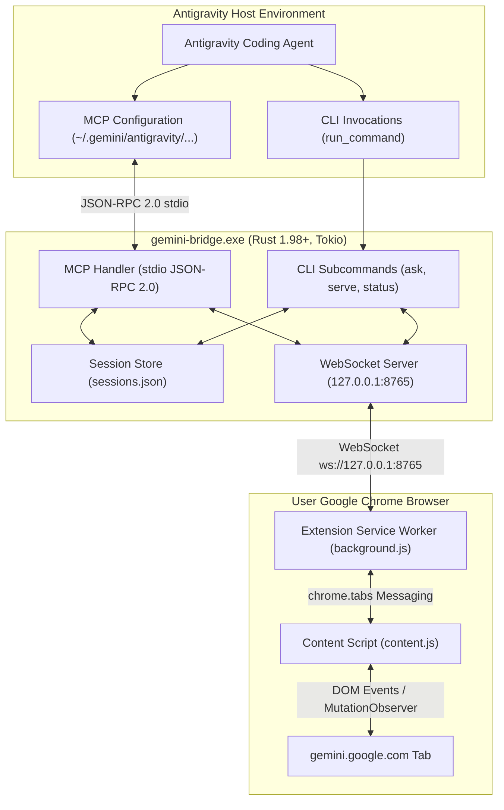

# Gemini-Bridge Architecture & Protocol Specification

## System Overview



---

## 1. WebSocket Protocol Specification

All WebSocket frames are JSON strings encoded in UTF-8.

### Bridge $\rightarrow$ Extension Messages

#### 1. `EXECUTE_PROMPT`
Instructs the extension to submit a prompt to Gemini.
```json
{
  "type": "EXECUTE_PROMPT",
  "id": "e4b3e839-4d2b-4560-b6c8-508a8a3a0a38",
  "conversation_id": "476fe739-31ea-4777-a7e3-f9f7c7c7a34e",
  "chat_url": "https://gemini.google.com/app/1a2b3c4d5e", // null if new chat
  "model": "Gemini 4 Argon",
  "prompt": "Write a concurrent cache in Rust with sharding.",
  "timeout_secs": 180
}
```

#### 2. `PING`
Keep-alive probe.
```json
{
  "type": "PING",
  "timestamp": 1729674000
}
```

---

### Extension $\rightarrow$ Bridge Messages

#### 1. `PROMPT_RESPONSE`
Returns the generated text or error status.
```json
{
  "type": "PROMPT_RESPONSE",
  "id": "e4b3e839-4d2b-4560-b6c8-508a8a3a0a38",
  "status": "SUCCESS", // "SUCCESS" | "ERROR" | "TIMEOUT"
  "content": "```rust\n// generated code\n```",
  "chat_url": "https://gemini.google.com/app/1a2b3c4d5e",
  "error": null
}
```

#### 2. `STATUS_UPDATE`
Notifies daemon about extension and tab state.
```json
{
  "type": "STATUS_UPDATE",
  "connected": true,
  "active_tab_found": true,
  "current_chat_url": "https://gemini.google.com/app/1a2b3c4d5e",
  "current_model": "Gemini 4 Argon"
}
```

#### 3. `PONG`
```json
{
  "type": "PONG",
  "timestamp": 1729674000
}
```

---

## 2. MCP Specification (Model Context Protocol)

The bridge implements standard MCP JSON-RPC 2.0 over `stdio`.

### Registered Tools
1. `ask_gemini_argon`:
   - **Description:** Submit a query, coding task, or architecture request to Google Gemini (Gemini 4 Argon). Automatically attaches to the current conversation thread or initiates a new one.
   - **Input Schema:**
     - `prompt` (string, required): The prompt or instructions for Gemini.
     - `context` (string, optional): Additional code, logs, or file contents to include.
     - `new_chat` (boolean, optional): Force a fresh chat session instead of continuing current thread.
     - `conversation_id` (string, optional): Override the conversation tracking key.
2. `gemini_bridge_status`:
   - **Description:** Check connection state between Antigravity, the Rust daemon, and the Chrome extension.
3. `new_gemini_chat`:
   - **Description:** Explicitly reset the chat URL for the current Antigravity conversation.
